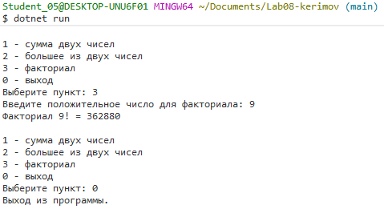
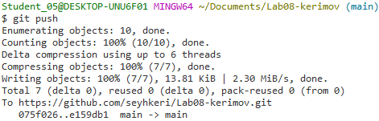

# Практическая работа №8
**ФИО:** Керимов Сейхан Заурбекович
**Группа:** ИСП-243
**Дата:** 17.10.2026

## Что изучено
Отличие void-методов от методов с return: Метод с типом void просто выполняет заложенный внутри него алгоритм действий и ничего не возвращает в место вызова, в то время как метод с указанным типом данных обязан вернуть результат вычислений с помощью ключевого слова return
Передача данных через параметры: Научился передавать входные аргументы в методы, что позволяет использовать один и тот же участок кода для работы с разными переменными, массивами и объектами
Устранение дублирования кода: Понял, как выносить часто повторяющиеся математические вычисления или блоки логики в отдельные именованные методы, что делает код чище и упрощает его дальнейшее редактирование.

## Скриншоты

